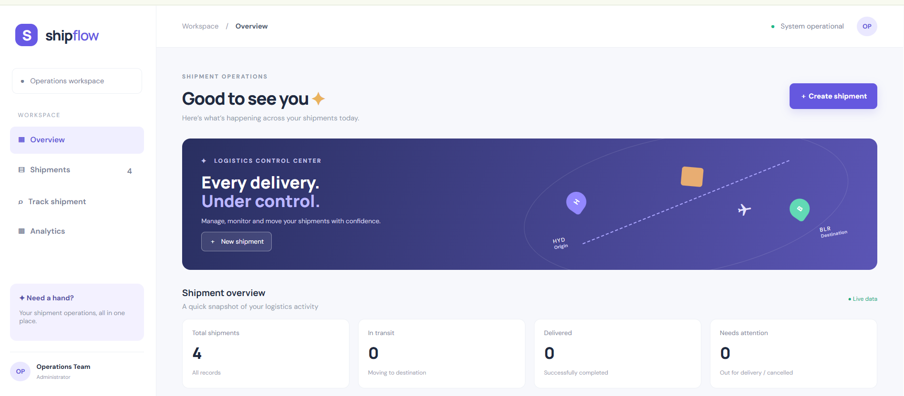
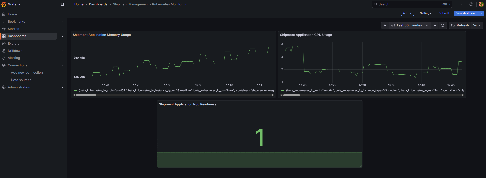
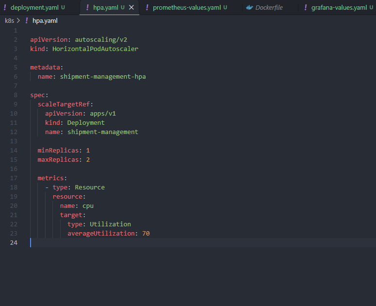

# Shipment Management Application – AWS DevOps Project

An end-to-end DevOps implementation of a Shipment Management application using AWS, Terraform, Docker, Kubernetes, Prometheus and Grafana.

The project demonstrates cloud infrastructure provisioning, containerization, application deployment, Kubernetes orchestration, autoscaling, monitoring, alerting and automated pod recovery.

## Project Overview

The Shipment Management application provides a graphical interface for creating, viewing and managing shipment records.

The application is built using Java Spring Boot with a web-based frontend and is containerized using Docker. AWS infrastructure is provisioned using Terraform, and the application is deployed on Amazon EKS.

Prometheus collects Kubernetes and container metrics, while Grafana provides dashboards and alerting.

## Technology Stack

| Category | Technologies |
|---|---|
| Application | Java 21, Spring Boot, HTML, CSS, JavaScript |
| Build | Maven |
| Containerization | Docker |
| Container Registry | Amazon ECR |
| Cloud Platform | AWS |
| Infrastructure as Code | Terraform |
| Container Orchestration | Kubernetes, Amazon EKS |
| Package Management | Helm |
| Autoscaling | Kubernetes HPA |
| Metrics Collection | Prometheus, Metrics Server, kube-state-metrics |
| Monitoring & Alerting | Grafana |
| Version Control | Git, GitHub |

## Architecture

```text
                 Developer
                     |
                     v
                Git / GitHub
                     |
                     v
              Docker Build
                     |
                     v
                Amazon ECR
                     |
                     v
              Amazon EKS
                     |
          +----------+----------+
          |                     |
          v                     v
   Shipment Application     Kubernetes HPA
          |
          v
      ClusterIP Service
          |
          v
     Application Pods
          |
          v
   Prometheus Monitoring
          |
          v
        Grafana
          |
          v
   Dashboards & Alerts
```

AWS infrastructure is provisioned using Terraform.

## AWS Infrastructure

The following AWS resources were provisioned using Terraform:

- Amazon VPC with CIDR `10.0.0.0/16`
- Two public subnets across Availability Zones
- Two private subnets across Availability Zones
- Internet Gateway
- Public and private route tables
- Amazon ECR repository
- Amazon EKS cluster
- EKS managed node group
- IAM roles and policy attachments

**Infrastructure design considerations:**

- AWS region: Mumbai (`ap-south-1`)
- Worker node instance type: `t3.medium`
- Single worker node for the learning environment
- No NAT Gateway
- Kubernetes application exposed internally through ClusterIP
- Grafana and Prometheus accessed using Kubernetes port forwarding

## Application Containerization

The application uses a multi-stage Docker build.

**Build stage:**
- Maven image with Java 21
- Compiles the Spring Boot application
- Packages the application JAR

**Runtime stage:**
- Lightweight Java 21 JRE image
- Runs the packaged Spring Boot application

The Docker image is pushed to Amazon ECR and pulled by Kubernetes during deployment.

## Kubernetes Deployment

The application is deployed on Amazon EKS using Kubernetes manifests.

Components implemented:

- Deployment
- ClusterIP Service
- Resource requests and limits
- Startup probe
- Readiness probe
- Liveness probe
- Horizontal Pod Autoscaler

### Resource Configuration

| Resource | Request | Limit |
|---|---:|---:|
| CPU | 250m | 1000m |
| Memory | 512Mi | 1024Mi |

### Health Checks

Spring Boot Actuator endpoints are used for Kubernetes health checks:

- `/actuator/health/liveness`
- `/actuator/health/readiness`

These probes help Kubernetes determine whether the application has started, is healthy and is ready to receive traffic.

## Horizontal Pod Autoscaling

Configured Kubernetes HPA using CPU utilization.

| Setting | Value |
|---|---:|
| Minimum replicas | 1 |
| Maximum replicas | 2 |
| CPU utilization target | 70% |

**Autoscaling test performed:**

1. Deployed the application with one replica.
2. Generated temporary CPU load using a BusyBox pod.
3. Observed CPU utilization increase.
4. Verified HPA scaling from one replica to two replicas.
5. Removed the load generator.
6. Observed the application scale back to one replica.

## Monitoring with Prometheus and Grafana

Prometheus was installed using Helm to collect Kubernetes and container metrics.

Grafana was installed using Helm and configured with Prometheus as its data source.

### Grafana Dashboard

The monitoring dashboard includes:

1. **Shipment Application CPU Usage** – CPU consumption in millicores.
2. **Shipment Application Memory Usage** – Container memory consumption in MiB.
3. **Shipment Application Pod Readiness** – Current pod readiness status.

Additional Kubernetes metrics were enabled using kube-state-metrics.

### Alerting Configuration

Three Grafana alert rules were configured:

| Alert | Condition | Severity |
|---|---|---|
| High CPU Usage | CPU above 800m | Warning |
| High Memory Usage | Memory above 819.2MiB | Warning |
| Pod Not Ready | Available replicas below desired replicas | Critical |

Evaluation intervals and pending periods were configured to reduce unnecessary alerts from short-lived fluctuations.

Email notification delivery was not configured because SMTP setup was deferred.

## Kubernetes Self-Healing Demonstration

A controlled pod deletion test was performed to demonstrate Kubernetes self-healing and Grafana alerting.

**Test procedure:**

```powershell
kubectl delete pod -l app=shipment-management
```

Kubernetes detected that the available replica count had fallen below the desired replica count.

The Deployment controller automatically created a replacement pod.

Prometheus collected the updated deployment metrics, and Grafana changed the pod availability alert from Normal to Firing/Unhealthy.

After the replacement pod became Ready, Grafana automatically returned the alert to Normal.

This demonstrated:

- Kubernetes desired-state reconciliation
- Automatic pod recreation
- Prometheus metric collection
- Grafana alert evaluation
- Alert recovery after application availability was restored

## Project Structure

```text
shipment-management/
│
├── src/
│   └── main/
│       ├── java/
│       │   └── com/example/shipment/
│       └── resources/
│           ├── application.properties
│           └── static/
│               ├── index.html
│               ├── app.js
│               └── styles.css
│
├── infrastructure/
│   └── terraform/
│       ├── provider.tf
│       ├── variables.tf
│       ├── vpc.tf
│       ├── ecr.tf
│       ├── eks.tf
│       ├── outputs.tf
│       └── .terraform.lock.hcl
│
├── k8s/
│   ├── deployment.yaml
│   ├── service.yaml
│   └── hpa.yaml
│
├── Dockerfile
├── pom.xml
├── .dockerignore
├── .gitignore
├── prometheus-values.yaml
├── grafana-values.yaml
└── README.md
```

## Deployment Workflow

The project was implemented through the following stages:

1. Provision AWS infrastructure using Terraform.
2. Create an Amazon ECR repository.
3. Build the application Docker image.
4. Push the image to Amazon ECR.
5. Create the Amazon EKS cluster and managed node group.
6. Configure kubectl access to EKS.
7. Deploy the application using Kubernetes manifests.
8. Configure Metrics Server and HPA.
9. Install Prometheus and Grafana using Helm.
10. Configure monitoring dashboards and alert rules.
11. Perform autoscaling and pod self-healing tests.

## Cost Optimization

The learning environment was designed with cost control in mind.

- Used one `t3.medium` worker node.
- Avoided NAT Gateway charges.
- Used ClusterIP instead of an AWS LoadBalancer.
- Disabled persistent storage for Prometheus and Grafana.
- Kept monitoring workloads on the existing worker node.
- Used a limited HPA replica range.
- Deleted ECR images after completing the project.
- Destroyed AWS infrastructure after completing the exercises.

**Note:** The AWS resources used for this learning implementation have been destroyed after project completion. The Terraform configuration and deployment manifests are retained in this repository for future reuse.

## Future Enhancements

The following improvements are planned for a subsequent project iteration:

- Jenkins-based CI/CD automation.
- Automated Docker build and ECR image publishing.
- Automated Kubernetes deployment through Jenkins.
- Amazon RDS integration for persistent shipment data.
- Gmail SMTP integration for Grafana alert notifications.
- Application-level monitoring using Micrometer and Prometheus.
- Improved secrets management and IAM security.
- Production-oriented deployment and networking architecture.

## Learning Outcomes

This project provided practical experience with:

- AWS infrastructure provisioning using Terraform.
- Docker multi-stage builds.
- Amazon ECR and Amazon EKS.
- Kubernetes deployments, services and probes.
- Kubernetes Horizontal Pod Autoscaling.
- Helm-based installation of monitoring tools.
- Prometheus


## Application Screenshots

### Shipment Management Homepage


### Grafana Dashboard


### Kubernetes HPA Scaling

